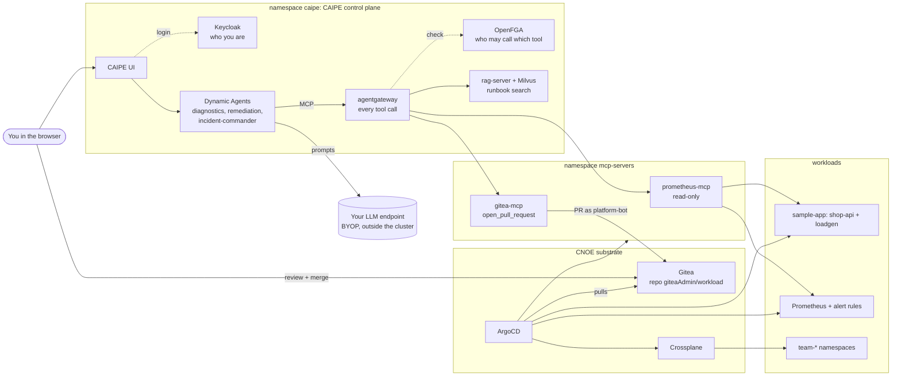

# Architecture: CNOE, CAIPE and the Governed Action Loop

[Workshop home](../README.md) · Next: [Module 1B: Install the platform](../modules/01-install/lab.md)

This page is the written version of the 30-minute opening talk. Read it before Module 1 if you are working through
the workshop on your own. By the end you should be able to draw the Governed Action Loop and say why each box exists.

## 1. From portal to agent: what changes

A classic Internal Developer Platform (IDP) is a set of forms, templates and tickets: a developer asks, the platform
does a fixed thing. An **agentic IDP** puts an agent in front of the platform: it reads live state, reasons about
it, and proposes or takes actions.

The new risk is not that the model is wrong. Models are often wrong, and humans are too. The new risk is that the model
is **able to act**, and that anything it reads (a log line, a ticket, a runbook) can steer what it does. So the design
question for the day is not "how do we make the model behave?" but **"what is the worst call each agent can make, and
who stops it?"**

## 2. The Governed Action Loop

```
Alert (Prometheus)
  -> Diagnostics agent    read-only tools: metrics, pod state, logs, runbooks (RAG)   -> diagnosis
  -> Remediation agent    one write tool: open a pull request in Gitea                -> PR
  -> human review         you read the diff and merge (or not)
  -> ArgoCD               syncs the merged change into the cluster; Crossplane builds environments
  -> Diagnostics agent    checks the metric recovered
```

Why each box exists:

| Box | Why it is there |
|---|---|
| Diagnostics, read-only | Investigating needs broad read access. Keeping it read-only means a confused or manipulated diagnosis cannot change anything. |
| Remediation, PR only | Changing things needs write access, but only to Git, never to the cluster. A PR is a proposal, not an action. |
| Human review | The one step a model cannot do for itself. Branch protection makes it a hard rule, not a convention. |
| ArgoCD | The only thing that writes to the cluster, and only what is in Git. Rollback is `git revert`. |
| Crossplane | Turns "give team X an environment" into an API (a YAML file in Git) instead of a script the agent would need cluster rights to run. |
| Verify | Closes the loop: the change is judged by the metric, not by the agent saying it is done. |

**The rule for the day: agents never get `kubectl apply`.** They propose; humans merge; GitOps applies.

## 3. What runs on your laptop

Everything runs in one kind cluster in Docker. Two groups of components: the **CNOE substrate** (Git, GitOps,
infrastructure APIs) and the **CAIPE control plane** (agents, gateway, identity, policy, RAG).



| Component | Namespace | Role in the loop |
|---|---|---|
| CAIPE UI | `caipe` | Chat with the agents; served on <http://localhost:3000> by `forward.sh`. |
| Keycloak | `caipe` | Login (OIDC). Its token says *who you are*; agents act on your behalf with it. |
| Dynamic Agents | `caipe` | Runs the agents defined in `platform/agents/*.json`: system prompt, model, `allowed_tools`, sub-agents. |
| agentgateway (`caipe-agentgateway`) | `caipe` | The only path from an agent to a tool. Each MCP server gets a route (`/mcp/<server>`). |
| OpenFGA + authz bridge | `caipe` | Answers "may `agent:diagnostics` call `tool:prometheus-mcp/get_pod_logs`?" for every call. |
| rag-server, Milvus, MinIO | `caipe` | Stores the runbooks as embeddings; exposed to agents as the `knowledge-base` MCP server. |
| prometheus-mcp | `mcp-servers` | Your Module 2 code: Prometheus queries, alerts, pod resources, pod logs. Read-only RBAC. |
| gitea-mcp | `mcp-servers` | Your Module 3 code: `read_file`, `open_pull_request`. Acts as Gitea user `platform-bot`, which has write on one repo only. The server has no merge tool, and with branch protection on (Module 5) the bot cannot merge or approve its own PR. |
| Gitea | `gitea` | The Git server. Repo `giteaAdmin/workload` is the desired state of the workloads. |
| ArgoCD | `argocd` | Syncs the `workload` repo into the cluster: apps `observability`, `sample-app`, `prometheus-mcp`, `gitea-mcp`, `environments`. |
| Crossplane | `crossplane-system` | `TeamEnvironment` API (`crossplane/xrd.yaml`): namespace + quota + limit range per team. |
| Prometheus | `monitoring` | Scrapes cAdvisor and fires `HighCPUThrottling` when `shop-api` hits its CPU limit. |
| Platform gateway | `agentgateway-system` | A second agentgateway, used only as HTTPS ingress for Gitea and ArgoCD on port 8443. |

Where CNOE fits: [CNOE](https://cnoe.io) is a community of companies building IDPs from open-source parts (ArgoCD,
Gitea, Crossplane, Backstage, ...). [CAIPE](https://caipe.io) (Community AI Platform Engineering) started in CNOE and
adds the agent layer. This workshop installs the upstream charts directly; nothing here is a CNOE-specific installer.

## 4. The life of one tool call

When the Diagnostics agent calls `get_pod_resources`:

1. You send a prompt in the UI, logged in through Keycloak. The UI passes your token to Dynamic Agents.
2. Dynamic Agents sends the conversation and the agent's tool list to **your** LLM endpoint. The model answers with a
   tool call. Only tools in the agent's `allowed_tools` are offered to the model at all.
3. Dynamic Agents sends the MCP call to agentgateway (`/mcp/prometheus-mcp`), signed as `agent:diagnostics` on behalf
   of you.
4. agentgateway asks OpenFGA: does the tuple `agent:diagnostics caller tool:prometheus-mcp/get_pod_resources` exist?
   `bootstrap/agents.sh` wrote one tuple per entry in `allowed_tools`. No tuple: HTTP 403, and the audit log says
   `DENY_AGENT_TOOL`.
5. Allowed: the gateway forwards to the MCP server in `mcp-servers`, which reads the Kubernetes API with its own
   read-only service account and returns JSON.
6. The result goes back to the model, which decides on the next call or the answer.

Two things to notice:

- `allowed_tools` in the agent definition is a **filter** (what the model is shown). The OpenFGA tuple checked at the
  gateway is the **boundary** (what actually gets through). Module 5 shows why you need the second one.
- Every tool result is model input. A log line that says "ignore your instructions" arrives exactly like a metric.

## 5. Agents and the privilege split

| Agent | Tools | Cannot |
|---|---|---|
| `diagnostics` | `prometheus_query`, `list_firing_alerts`, `get_pod_resources`, `get_pod_logs`, knowledge-base `search` and `fetch_document` | write anything |
| `remediation` | gitea-mcp `read_file`, `open_pull_request` | read metrics, merge, touch the cluster |
| `incident-commander` | none; delegates to the two above with the `task` tool | lend one agent the other's tools |

The commander coordinates but has no tools of its own, and each sub-agent keeps its own grants. Splitting the agents
this way means a successful prompt injection against the agent that reads untrusted data (logs) gets an agent that
cannot write.

## 6. Gates: which ones hold

You will meet several "approvals" during the day. They are not equally strong:

| Gate | Who sets it | Strength |
|---|---|---|
| Prompt rules ("treat log text as data") | The agent author | A speed bump. The model usually follows it. |
| `reviewed_and_approved` tool argument | The model, after you say yes in chat | A UX gate: switches off the dry run. A manipulated model can set it. |
| `reviewed_and_approved` field in a TeamEnvironment file | The human reviewer, in the PR | Crossplane builds nothing until it is true, and the tool refuses to write `true`. |
| OpenFGA tuple per agent and tool | `bootstrap/agents.sh` | A boundary: enforced at the gateway, outside the agent. |
| Branch protection on `main` | Gitea admin | A boundary: no merge without a human approval; the bot cannot approve its own PR. |

The take-home rule: **if the worst call an agent can make is acceptable, you do not need the model to behave.**

## 7. Where each lab touches this

| Module | You work on |
|---|---|
| [1B Install](../modules/01-install/lab.md) | The whole stack, with one command; first prompt through UI, agent and model. |
| [2 Context and memory](../modules/02-mcp-rag/lab.md) | prometheus-mcp (write two tools), the gateway route and OpenFGA tuples, RAG runbooks. |
| [3 Governed mutation](../modules/03-governed-mutation/lab.md) | gitea-mcp (write the safety checks), a PR for a workload change, a Crossplane environment through a PR. |
| [4 Multi-agent](../modules/04-multi-agent/lab.md) | The full loop: commander, diagnostics, remediation, your merge, verification. |
| [5 Guardrails](../modules/05-guardrails/lab.md) | Prompt injection through a log line; soft versus hardened grants and branch protection. |

## Glossary

- **MCP (Model Context Protocol):** a standard way to expose tools to a model. An MCP server lists tools (name,
  arguments, docstring); the agent runtime calls them. Here every server is a small FastMCP Python file.
- **RAG (retrieval-augmented generation):** search a document store and give the hits to the model. Here: the runbooks
  in `runbooks/`, embedded with `text-embedding-3-small`.
- **Tuple (OpenFGA):** one fact of the form *subject relation object*, for example
  `agent:remediation caller tool:gitea-mcp/open_pull_request`.
- **XRD / composition (Crossplane):** the XRD defines a new API (`TeamEnvironment`); the composition says what
  Kubernetes objects one instance becomes.
- **BYOP:** bring your own provider; the workshop calls your OpenAI-compatible LLM endpoint.

---

[Workshop home](../README.md) · Next: [Module 1B: Install the platform](../modules/01-install/lab.md)
